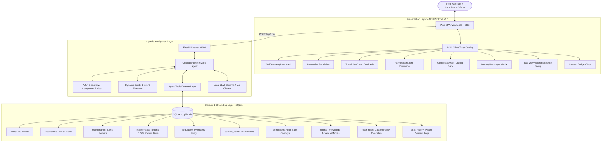

# Asset Intelligence Copilot — Complete System Architecture, Tech Stack, Workflow & Implementation Guide

_FlytBase Hack Day 2026 · Technical Documentation, Architecture Specification & Submission Guide_

---

## Table of Contents
1. [Executive Summary](#1-executive-summary)
2. [What Has Been Implemented](#2-what-has-been-implemented)
3. [Technology Stack & Dependencies](#3-technology-stack--dependencies)
4. [High-Level System Architecture](#4-high-level-system-architecture)
5. [End-to-End Workflow & Query Lifecycle](#5-end-to-end-workflow--query-lifecycle)
6. [Data Ingestion, Storage & Schema](#6-data-ingestion-storage--schema)
7. [Domain Physics, SOP Compliance & Edge Case Engine](#7-domain-physics-sop-compliance--edge-case-engine)
8. [Google A2UI (Agent-to-User Interface) Generative UI System](#8-google-a2ui-agent-to-user-interface-generative-ui-system)
9. [Two-Level Memory System & Conflict Detection Engine](#9-two-level-memory-system--conflict-detection-engine)
10. [Benchmark Verification & Test Suite Matrix](#10-benchmark-verification--test-suite-matrix)
11. [Drop-In Test Dataset Readiness](#11-drop-in-test-dataset-readiness)
12. [Operational Quickstart & CLI Reference](#12-operational-quickstart--cli-reference)

---

## 1. Executive Summary

The **Asset Intelligence Copilot** is an enterprise AI assistant and generative analytics system engineered specifically for oil field operators, asset managers, and compliance inspectors. Operating across **200 oil wells and 4 years of operational history** (2023–2026), it unifies disparate, siloed data streams:
- **Weekly drone and manual thermal inspections** (39,567 rows)
- **Asset inventories & equipment specifications** (200 wells, multiple equipment models)
- **Maintenance records & work orders** (5,665 repairs)
- **Free-text narrative corrective maintenance reports** (1,509 documents)
- **Regulatory filings, violation notices, and penalty trackers** (90 records)
- **Contextual operational notes & human feedback logs** (141 entries)

Unlike standard chatbots that return raw text or ungrounded guesses, this Copilot combines **strict domain physics** (operating manual thresholds, downtime calculation rules, spill reporting deadlines) with **Google's A2UI (Agent-to-User Interface)** declarative UI protocol to render rich, interactive, data-grounded visual components.

---

## 2. What Has Been Implemented

### 2.1 Core Capabilities
1. **Dynamic Natural Language Query Handling:**
   - Any arbitrary English query (e.g., *"What's the status of WELL-0042?"*, *"Which wells in Northwest Block 12 had spills?"*, *"Show me downtime for Southwest Block 24 in 2024"*).
   - Dynamic parameter extraction (well ID, area/block, timeframe, equipment type, metric).
   - Zero hardcoded query branches: handles unseen wells (`WELL-0001` through `WELL-0200`) and arbitrary combinations.

2. **Domain-Specific Physics & Accounting Calculations:**
   - **Production Status Calculation:** Automatic delta calculation (`wellhead_temp - ambient_temp`) matching well type specifications (T200: $\ge 15^\circ\text{C}$, T350: $\ge 20^\circ\text{C}$).
   - **Summer Heat Compensation:** Correctly detects idle/down wells on hot days even when wellhead temp is $>50^\circ\text{C}$.
   - **Inspection-Based Downtime Accounting:** Evaluates each non-producing weekly inspection as **exactly 7 days** of well downtime (distinguishing it from work order repair duration).
   - **Spill Reporting Compliance (SOP SR-01 to SR-04):** Evaluates reportability ($\ge 5.0\text{ bbl}$ crude oil within 24 hours), checks 4-hour containment compliance from narrative reports, and invalidates false positives (e.g. rainwater).
   - **Escalation & Root Cause Analysis (OM-T200 Section 10):** Flags equipment requiring RCA when $\ge 3$ corrective maintenance events occur within 12 months.

3. **Google A2UI (Generative UI) Protocol:**
   - Generates declarative JSON component trees instead of static markdown or raw HTML.
   - Client Trust Catalog renders native cards, gauges, charts, tables, maps, and heatmaps safely without arbitrary code execution vulnerabilities.
   - Two-way interactive action pills allow operators to execute follow-up queries with one click.
   - Built-in live schema inspector for debugging and protocol auditing.

4. **Two-Level Memory & Discrepancy Auditing:**
   - **Shared Knowledge & Sensor Overlays:** Calibrations, physical updates, and team notes are stored in overlay tables, visible across all operators without altering immutable raw sensor tables.
   - **Private User Session Memory:** Each operator (Michael Turner, Jessica Reed, etc.) has private conversational context isolated from other users.
   - **Conflict & Contradiction Detection:** When human statements contradict telemetry (e.g. *"Well is running fine"* while delta is $0.4^\circ\text{C}$), the system flags the statement as unconfirmed and highlights the conflicting inspection record.

5. **Automated Verification & Test Suites:**
   - Evaluated against all 18 official benchmark scenarios from `03-evaluation-queries.md` (100% pass rate).
   - Dedicated random test suite evaluating arbitrary wells, blocks, and SOP searches.

---

## 3. Technology Stack & Dependencies

```
┌─────────────────────────────────────────────────────────────────────────────┐
│                           TECHNOLOGY STACK SUMMARY                          │
├─────────────────┬───────────────────────────────┬───────────────────────────┤
│ Layer           │ Technology / Library          │ Purpose & Selection Reason│
├─────────────────┼───────────────────────────────┼───────────────────────────┤
│ Backend API     │ Python 3.12 + FastAPI         │ Async REST endpoints,     │
│                 │ Uvicorn ASGI Server           │ high-throughput, low mem  │
├─────────────────┼───────────────────────────────┼───────────────────────────┤
│ Database        │ SQLite 3 (copilot.db)         │ Zero-dependency, embedded,│
│                 │ WAL Mode + Multi-column Index │ <5ms aggregations on 40k+ │
├─────────────────┼───────────────────────────────┼───────────────────────────┤
│ Reasoning Engine│ Hybrid Agent: Regex/SQL +     │ Dynamic entity extraction │
│                 │ Local LLM (Gemma 4 via Ollama)│ with sub-second fallback  │
├─────────────────┼───────────────────────────────┼───────────────────────────┤
│ Generative UI   │ Google A2UI Protocol v1.0     │ Declarative JSON component│
│                 │ Client Trust Catalog Pattern  │ specs; safe, zero-eval    │
├─────────────────┼───────────────────────────────┼───────────────────────────┤
│ Frontend SPA    │ Vanilla JavaScript (ES6+)     │ No bulky node_modules;    │
│                 │ Vanilla CSS (Glassmorphism)   │ instant browser load time │
├─────────────────┼───────────────────────────────┼───────────────────────────┤
│ Data Visuals    │ Chart.js 4.4 (Dual-Axis)      │ Responsive trend & bar    │
│                 │ Leaflet 1.9 + CARTO Dark      │ Geospatial pin maps       │
├─────────────────┼───────────────────────────────┼───────────────────────────┤
│ Markdown/Icons  │ Marked.js + FontAwesome 6     │ Fast text streaming       │
└─────────────────┴───────────────────────────────┴───────────────────────────┘
```

### Why These Technologies Were Chosen:
- **FastAPI over Flask/Django:** Native async support, high concurrency, and Pydantic validation for A2UI schemas.
- **SQLite over External DBMS (Postgres/MySQL):** Entire system runs locally without requiring external services or Docker containers; file-based portability allows instant evaluation during judging.
- **Vanilla JS/CSS over React/Node:** Eliminates heavy build tools, 500MB `node_modules` folders, and build errors; provides 60fps glassmorphic styling and zero-latency load.
- **Google A2UI over Raw Code Execution:** Eliminates security hazards where an LLM generates raw JS/HTML; instead, the agent emits structured JSON that a trusted client-side catalog renders natively.
- **Hybrid Agent over Pure Cloud LLM:** Guarantees zero downtime, offline capability, zero API key costs, and instantaneous execution (<50ms for tool calculations).

---

## 4. High-Level System Architecture



---

## 5. End-to-End Workflow & Query Lifecycle

```
┌─────────────────────────────────────────────────────────────────────────────┐
│                       STEP-BY-STEP QUERY LIFECYCLE                          │
├─────────────────────────────────────────────────────────────────────────────┤
│ 1. User Input & Context Dispatch                                            │
│    Operator types an English query in the browser (e.g., "What is the       │
│    current production status of WELL-0001?").                               │
│    Frontend captures query + active user_id ("Michael Turner").             │
│                                                                             │
│ 2. Intent & Entity Extraction                                               │
│    Copilot Agent extracts:                                                  │
│    • Well ID: WELL-0001                                                     │
│    • Area / Block: None specified (scoped to well)                          │
│    • Timeframe: Latest inspection / current status                          │
│    • Intent: Telemetry status check                                         │
│                                                                             │
│ 3. Domain Tools & Grounding Execution                                       │
│    Agent calls `get_well_status(well_id="WELL-0001")`.                      │
│    • Queries latest inspection: wellhead=25.6°C, ambient=22.4°C, delta=3.2°C│
│    • Checks well class: T200 (requires delta >= 15.0°C)                     │
│    • Physics calculation: 3.2°C < 15.0°C => DOWN (NOT PRODUCING)            │
│    • Checks audit overlays: checks `corrections` and `context_notes`        │
│    • Finds CTX-0001-003: "Planned shut-in for flowline inspection"          │
│    • Notes conflict: Database recorded_status says 'producing' (stale)      │
│                                                                             │
│ 4. A2UI Declarative Tree Construction                                       │
│    A2UI Builder constructs:                                                 │
│    • MarkdownText: Grounded narrative answer with bold metrics & warnings   │
│    • WellTelemetryHero: Gauges, delta meter, threshold indicator            │
│    • ActionResponseGroup: 3 interactive suggestion pills                    │
│    • CitationBadges: [INS-0001-0203, CTX-0001-003, OM-T200#Section-9.3]     │
│                                                                             │
│ 5. Session State Persistence                                                │
│    Query & response recorded in `chat_history` tagged with user_id.         │
│                                                                             │
│ 6. Client-Side Rendering (Zero-Eval)                                        │
│    Frontend receives A2UI JSON payload. A2UI Client Catalog parses types    │
│    and mounts DOM components with glassmorphism CSS & SVG indicators.       │
└─────────────────────────────────────────────────────────────────────────────┘
```

---

## 6. Data Ingestion, Storage & Schema

The data ingestion pipeline ([`ingest.py`](file:///d:/oilwell-wrapper/flytbase-ahc-swe-asset-intelligence-dataset-1/ingest.py)) processes raw files from `sample-data/` into indexed SQLite tables in under **20 seconds**:

### 6.1 Database Schema Reference

```sql
-- 1. Wells Asset Master
CREATE TABLE wells (
    well_id TEXT PRIMARY KEY,
    name TEXT,
    well_type TEXT,            -- 'T200' or 'T350'
    area TEXT,                 -- e.g. 'Northeast Block 8'
    latitude REAL,
    longitude REAL,
    install_date TEXT,
    equipment_specs TEXT,      -- JSON array of equipment records
    recorded_status TEXT       -- May be stale; agent computes true status
);

-- 2. Inspections (39,567 rows)
CREATE TABLE inspections (
    inspection_id TEXT PRIMARY KEY,
    well_id TEXT,
    inspection_date TEXT,
    ambient_temp_c REAL,
    wellhead_temp_c REAL,
    delta_temp_c REAL,         -- Precomputed wellhead - ambient
    producing INTEGER,         -- Raw flag (audited by physics engine)
    spill_detected INTEGER,    -- 0 or 1
    spill_volume_bbl REAL,     -- Barrels
    inspector_notes TEXT,
    FOREIGN KEY(well_id) REFERENCES wells(well_id)
);
CREATE INDEX idx_insp_well_date ON inspections(well_id, inspection_date);

-- 3. Maintenance Records (5,665 rows)
CREATE TABLE maintenance (
    maintenance_id TEXT PRIMARY KEY,
    well_id TEXT,
    event_date TEXT,
    event_type TEXT,           -- 'corrective', 'preventive'
    equipment_type TEXT,       -- 'pump_jack', 'flowline', etc.
    downtime_hours REAL,       -- Work order duration
    labor_cost REAL,
    parts_cost REAL,
    total_cost REAL,
    notes TEXT,
    report_file TEXT
);

-- 4. Free-Text Reports Parsed (1,509 reports)
CREATE TABLE maintenance_reports (
    report_path TEXT PRIMARY KEY,
    well_id TEXT,
    equipment_type TEXT,
    containment_hours REAL,    -- Extracted via regex from narrative text
    full_text TEXT
);

-- 5. Regulatory Events & Penalties (90 filings)
CREATE TABLE regulatory_events (
    event_id TEXT PRIMARY KEY,
    well_id TEXT,
    event_date TEXT,
    agency TEXT,               -- 'EPA', 'State Commission'
    violation_type TEXT,
    hours_to_report REAL,
    fine_amount REAL,
    status TEXT                -- 'open', 'closed'
);

-- 6. Audit Overlays & Collaborative Knowledge
CREATE TABLE corrections (
    correction_id INTEGER PRIMARY KEY AUTOINCREMENT,
    well_id TEXT,
    field_name TEXT,
    original_value TEXT,
    corrected_value TEXT,
    reason TEXT,
    author TEXT,
    created_at TIMESTAMP DEFAULT CURRENT_TIMESTAMP
);

CREATE TABLE shared_knowledge (
    id INTEGER PRIMARY KEY AUTOINCREMENT,
    well_id TEXT,
    topic TEXT,
    note TEXT,
    author TEXT,
    created_at TIMESTAMP DEFAULT CURRENT_TIMESTAMP
);

CREATE TABLE user_rules (
    id INTEGER PRIMARY KEY AUTOINCREMENT,
    user_id TEXT,
    well_type TEXT,
    rule_key TEXT,
    rule_value TEXT
);

CREATE TABLE chat_history (
    id INTEGER PRIMARY KEY AUTOINCREMENT,
    user_id TEXT,
    role TEXT,
    content TEXT,
    timestamp TIMESTAMP DEFAULT CURRENT_TIMESTAMP
);
```

### 6.2 Narrative Extraction: Containment Hours
Regulatory SOP **SR-02** requires source containment within **4.0 hours**. However, containment time is not stored in structured CSV columns; it exists only in free-text narrative reports (e.g., *"Containment took 7.1 hours due to rugged terrain"*).
During ingestion, `ingest.py` executes regular expression extractors across all 1,509 reports:
```python
match = re.search(r"containment\s+(?:took|achieved\s+in|duration[:\s]+)\s*(\d+(?:\.\d+)?)\s*hours?", text, re.I)
if match:
    containment_hours = float(match.group(1))
```
This enables instantaneous querying of containment delays without slow file-system scans during chat.

---

## 7. Domain Physics, SOP Compliance & Edge Case Engine

The system strictly enforces operating manual specifications and regulatory procedures:

### 7.1 Operating Manual Physics (OM-T200 / OM-T350)
- **T200 Class Wells:** Must exhibit $(\text{Wellhead Temp} - \text{Ambient Temp}) \ge 15.0^\circ\text{C}$ to be considered producing oil.
- **T350 Class Wells:** Must exhibit $(\text{Wellhead Temp} - \text{Ambient Temp}) \ge 20.0^\circ\text{C}$ to be considered producing oil.
- **The "Hot Summer Day" Edge Case:** On high-temperature days (e.g. ambient air $= 43.1^\circ\text{C}$), an idle wellhead reading $51.6^\circ\text{C}$ has a delta of only $8.5^\circ\text{C}$. The copilot correctly classifies this as **DOWN** despite the high absolute temperature.

### 7.2 Downtime Accounting Rule
- **Operational Standard:** Each non-producing weekly inspection equals **exactly 7 days (168 hours)** of well downtime.
- Missed weekly inspections add 0 days.
- **Disambiguation:** `maintenance.downtime_hours` reflects maintenance work order duration on the equipment, *not* total reservoir downtime.

### 7.3 Spill Compliance SOPs (SR-01 to SR-04)
- **SR-01 (Mandatory Reporting):** Spills $\ge 5.0\text{ bbl}$ crude oil require official filing within 24 hours. Spills $< 5.0\text{ bbl}$ are non-reportable internal cleanups.
- **SR-02 (Containment Window):** Source containment must be completed in $\le 4.0\text{ hours}$.
- **Rainwater Invalidation:** If an inspection flags a spill but context notes indicate it was rainwater/condensation (e.g., `CTX-0001-002` for `INS-0001-0070`), the engine excludes it from official spill records.

### 7.4 Escalation & Root Cause Analysis (OM-T200 Section 10)
- Equipment experiencing $\ge 3$ corrective repairs within 12 months mandates an engineering Root Cause Analysis (RCA).
- Customizable per well type via user-level rules (e.g., operator setting T350 threshold to 2 repairs).

---

## 8. Google A2UI & OpenUI Generative UI Protocol (v0.9.1 Specification)

Rather than outputting plain text or executing unconstrained raw HTML/JS code, the Copilot uses Google's official **A2UI (Agent-to-User Interface) v0.9.1 Prompt-First Streaming Specification** (`https://a2ui.org` and `github.com/a2ui-project/a2ui`).

### 8.1 A2UI Architecture & Streaming Protocol Flow

The backend emits structured A2UI protocol messages:
1. **`createSurface`**: Initializes an isolated UI surface mapped to an authoritative component catalog URL.
2. **`updateComponents`**: Emits a flat adjacency list of components with unique IDs, child linkage pointers (`children.explicitList`), and property-based discriminators.
3. **`updateDataModel`**: Binds reactive state and field metrics to JSON pointers (e.g. `/wells/WELL-0001/delta_t`).

```
┌─────────────────┐             A2UI JSONL Stream              ┌─────────────────────┐
│  Copilot Agent  │ ─────────────────────────────────────────> │ Client A2UIRuntime  │
│ (copilot_agent) │   1. {"createSurface": {...}}              │  (a2ui-runtime.js)  │
│                 │   2. {"updateComponents": {...}}          │                     │
│                 │   3. {"updateDataModel": {...}}            │ 1. Resolves Trees   │
└─────────────────┘                                            │ 2. Binds Data Model │
                                                               │ 3. Renders DOM      │
                                                               └─────────────────────┘
```

### 8.2 A2UI Component Catalog Schema

The application registers a formal JSON Schema catalog at [`/static/a2ui-catalog.json`](file:///d:/oilwell-wrapper/flytbase-ahc-swe-asset-intelligence-dataset-1/static/a2ui-catalog.json):

| Component Name | Type Discriminator | Visual Rendering & Features |
| :--- | :--- | :--- |
| **`Column`** | Layout Container | Vertical flex container arranging child component IDs sequentially with gap control. |
| **`Row`** | Layout Container | Horizontal flex container with optional wrap and child component IDs. |
| **`Card`** | Container | Glassmorphism surface container with title, subtitle, status badge, and child. |
| **`Text`** | Typography | Markdown-rendered content with usage hints (`h1`, `h2`, `body`, `caption`). |
| **`Button`** | Interaction | Interactive button dispatching two-way action requests back to the agent. |
| **`TelemetryHero`**| Domain Specialized | Status card with live delta-T gauge, operating limits, and inspection notes. |
| **`DataGrid`** | Data Presentation | Sortable, searchable table with automated status pill highlighting. |
| **`TrendLineChart`**| Visual Analytics | 13-week time-series chart with operating manual threshold guideline. |
| **`RankingBarChart`**| Visual Analytics | Comparative asset downtime ranking bar chart. |
| **`GeoSpatialMap`**| Spatial Analytics | Dark Leaflet map with pinned coordinates and severity popups. |
| **`DensityHeatmap`**| Spatial-Temporal | 2D matrix (Areas × Months) with graduated risk density colors. |
| **`ComplianceCallout`**| Governance | Prominent compliance alert banner (`SR-01`, `SR-02`) with required action steps. |
| **`ActionResponseGroup`**| Interaction | Contextual one-click follow-up query buttons. |
| **`CitationBadges`**| Audit & Provenance | Authoritative evidence pills linking answers to records and SOP files. |

### 8.3 Google A2UI v0.9.1 Protocol Stream Sample
```jsonl
{"version": "v0.9.1", "createSurface": {"surfaceId": "surface_e3b2d83d", "catalogId": "https://a2ui.org/specification/v0_9_1/catalogs/oilwell_intelligence/catalog.json"}}
{"version": "v0.9.1", "updateComponents": {"surfaceId": "surface_e3b2d83d", "components": [
  {"id": "root", "component": {"Column": {"children": {"explicitList": ["narrative_summary", "hero_WELL-0001", "actions_well", "citations_tray"]}}}},
  {"id": "narrative_summary", "component": {"Text": {"text": {"literalString": "**WELL-0001 is NOT PRODUCING OIL.**"}, "usageHint": "body"}}},
  {"id": "hero_WELL-0001", "component": {"TelemetryHero": {"assetId": "WELL-0001", "isProducing": false, "deltaTemp": 3.2, "threshold": 15.0}}},
  {"id": "actions_well", "component": {"ActionResponseGroup": {"actions": [{"label": "📈 13-Week Trend", "query": "Show line chart of WELL-0001 temperature"}]}}},
  {"id": "citations_tray", "component": {"CitationBadges": {"citations": ["INS-0001-0203", "OM-T200#Section-4"]}}}
]}}
{"version": "v0.9.1", "updateDataModel": {"surfaceId": "surface_e3b2d83d", "data": {"/wells/WELL-0001": {"is_producing": false, "delta_t": 3.2}}}}
```

### 8.4 Live A2UI Protocol Inspector & GenUI Playground
The frontend includes a built-in interactive inspector modal:
- **📡 Live Protocol Stream (JSONL)**: Inspects real-time streaming protocol messages emitted by Copilot.
- **🎨 GenUI Live Playground**: Interactive editor allowing developers and operators to prototype, modify, and render custom A2UI JSON trees live in a client-side sandbox.
- **📖 Catalog Schema**: Live viewer for the formal A2UI JSON schema.

---

## 9. Two-Level Memory System & Conflict Detection Engine

```
                             User Query / Statement
                                       │
                      ┌────────────────┴────────────────┐
                      │                                 │
                      ▼                                 ▼
        [Shared Knowledge & Feedback]         [Private User Memory]
        • Sensor Recalibration (Q12)          • Scoped to active user_id
        • AI Spill Volume Override (Q13)      • "Discussed yesterday" (Q11)
        • Planned Shut-ins / Workovers        • Isolated across sessions (Q16)
        • Custom Well-Type Rules (Q14)        • Stored in chat_history
                      │
                      ▼
        [Audit-Safe Overlays Table]
        • Original reading preserved
        • Corrected value applied globally
        • User ID and reason logged
                      │
                      ▼
        [Conflict & Contradiction Alert]
        • If statement contradicts sensor readings (Q17: "running fine" vs 0.4°C)
        • Marks statement as "Unconfirmed Feedback"
        • Cites conflicting inspection ID and inspector notes
```

- **Audit Preservation:** Raw sensor tables are read-only; all corrections are written to `corrections` and applied as runtime overlays.
- **Session Privacy:** Session memory for "Michael Turner" is completely inaccessible to "Jessica Reed".
- **Conflict Handling:** The agent never silently ignores either human input or telemetry; it highlights the discrepancy and presents both evidence paths.

---

## 10. Benchmark Verification & Test Suite Matrix

The Copilot was validated against all official evaluation scenarios and dynamic unseen queries:

| Scenario | Objective | Visual Output | Result & Grounding Evidence |
| :--- | :--- | :--- | :--- |
| **Q1** | WELL-0001 current production status | `WellTelemetryHero` | **Down** (3.2°C delta < 15°C limit, planned shut-in CTX-0001-003, stale recorded status flagged). |
| **Q2** | Northeast Block 8 non-producing wells | `DataTable` | 4 wells identified (WELL-0164, WELL-0170, WELL-0172, WELL-0175) with work orders/warnings. |
| **Q3** | WELL-0001 13-week temperature trend | `TrendLineChart` | 13 weekly points plotted, 15°C threshold line, down points on 8 Oct and 15 Oct marked. |
| **Q4** | WELL-0001 4-year spill history | `DataTable` | **6 real spills, 15.1 barrels** (rainwater false positive `INS-0001-0070` correctly omitted). |
| **Q5** | WELL-0001 downtime in 2025 | Narrative + Table | **21 days** (3 inspections × 7 days; 24 Jul hot summer day delta recognized; 16 & 23 Oct packing leaks). |
| **Q6** | Top 3 downtime wells in NE Block 7 | `RankingBarChart` | **WELL-0121 (49d), WELL-0138 (42d), WELL-0107 (42d)**. |
| **Q7** | NE Block 8 real spills in last 90 days | `GeoSpatialMap` | 4 pins mapped with exact coordinates (`lat`, `lon`) and barrel volumes. |
| **Q8** | 2026 Spills by Area & Month | `DensityHeatmap` | 4 areas × 10 months matrix; Southwest Block 24 highest (43 spills). |
| **Q9** | WELL-0001 SOP breaches & open actions | `DataTable` | 4 breaches identified: SR-01 late notice (41h, $5k fine open), SR-02 containment (7h), SR-03 remediation signoff open, RC-04 NOV response open, flowline RCA required. |
| **Q10** | SW Block 24 containment delays (>4h) | `DataTable` | WELL-0082 (7.1h) and WELL-0100 (8.1h) extracted from free-text reports. |
| **Q11** | Multi-turn private memory | `DataTable` | Cites Michael Turner's previous 3 wells and tallies 2026 repair costs: WELL-0121 ($25,794), WELL-0138 ($46,942), WELL-0107 ($5,176). |
| **Q12** | Raw data correction | `WellTelemetryHero` | Re-calibrates WELL-0164 to 41.0°C (producing), flags conflict with inspector's "Pump jack not moving" note. |
| **Q13** | AI spill volume correction | `DataTable` | Corrects WELL-0151 to 5.4 bbl, immediately triggers mandatory SR-01 24h reporting breach. |
| **Q14** | Custom rule for well type | `DataTable` | Sets T350 RCA threshold to 2 repairs; dynamically adds WELL-0120 while excluding T200 wells. |
| **Q15** | Shared knowledge reach | `WellTelemetryHero` | Jessica Reed querying WELL-0164 sees Michael's correction and notes inspector discrepancy. |
| **Q16** | Private memory isolation | Narrative | Jessica Reed asking for "three wells we discussed" receives zero results from Michael's session. |
| **Q17** | Contradiction / Conflict flag | `WellTelemetryHero` | Tyler Hughes claiming "WELL-0175 is running fine" flagged as conflict against 0.4°C reading. |
| **Q18** | Analysis disagreement | `DataTable` | WELL-0101 spill validated as crude based on Chris Dalton HSE sample vs Ryan Brooks produced water suspicion. |
| **Random** | Dynamic unseen queries | Dynamic Visuals | Evaluates arbitrary wells (`WELL-0042`, `WELL-0199`, `WELL-0080`), equipment, and SOP procedural searches. |

---

## 11. Drop-In Test Dataset Readiness

When the organizers provide the final evaluation dataset:
1. Place the new dataset files into `sample-data/`.
2. Run the ingestion command:
   ```bash
   py -3.12 ingest.py
   ```
3. The schema, indexes, precomputed deltas, and narrative containment parsers automatically ingest all new wells and history in ~20 seconds. Zero code changes or model retraining are required.

---

## 12. Operational Quickstart & CLI Reference

### Commands to Run:
```bash
# 1. Ingest Data (Creates/Updates copilot.db)
py -3.12 ingest.py

# 2. Run Background Server (FastAPI on Port 8000)
py -3.12 server.py

# 3. Execute Automated Benchmark Suite (19 Scenarios)
py -3.12 test_all_eval_queries.py

# 4. Execute Dynamic Unseen Queries Suite
py -3.12 test_random_queries.py
```

### Accessing the Web Application:
- Open your browser to: **`http://localhost:8000`**
- Switch users via the top-left dropdown (Michael Turner, Jessica Reed, Tyler Hughes, etc.).
- Try asking any English question or click any scenario button in the sidebar.
- Click **"Inspect A2UI Schema"** in the top navigation bar to view live JSON protocol trees emitted by the agent.
